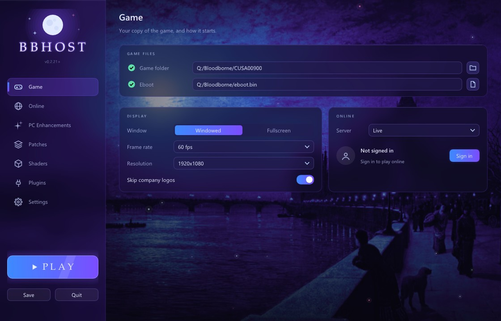

# bbhost

bbhost is a translation layer that runs Bloodborne on Windows and Linux. The
game's own 1.09 executable runs unmodified on the PC's x86-64 CPU; bbhost
answers its calls into the PS4's system libraries with PC implementations, and
recompiles its GPU work, GCN shaders and the engine's draw calls, for Vulkan.
The aim is a definitive PC version of the game - the original, intact, with
what a PC release would add: any resolution and aspect ratio, 60 fps and
beyond, keyboard and mouse, proper settings, mods and online play.


bbhost contains no game code or data. You need your own copy of the game: a
dump with the 1.09 update and its decrypted executable.

## Why not emulation

The PS4 has an x86-64 CPU, so the game's code does not need to be translated
to run on a PC - it needs a place to live. bbhost provides that place:

- **The CPU side runs natively.** bbhost loads the game's ELF executable,
  relocates it, links its imports to its own implementations and starts it.
  The game's code runs at full speed on the host CPU, with no interpreter or
  recompiler involved.
- **The PS4's system libraries are reimplemented** for the PC: files and
  saves, threads and memory, input, audio, movies, networking and the
  PlayStation Network calls the online features use - every one of the 660
  named functions the game imports.
- **Graphics are being moved from emulation to native code.** The game's
  renderer was written for the PS4's GPU: it builds command buffers for an AMD
  GCN GPU and ships GCN shader programs. bbhost hooks FromSoftware's own
  graphics layer instead, so draws, dispatches, clears and copies are built
  directly from the engine's objects, and decompiles the shaders to typed,
  structured SPIR-V, which it prints as HLSL for the player's PC to compile.
  The status table below shows what is native today and what the GPU command
  processor still emulates.
- **Game functions are being rewritten as source**, one at a time, each checked
  against the original, so the game can be fixed and extended where a patch
  would not reach.

## Features

| | |
|---|---|
|  | **Any resolution, ultrawide included.** 21:9 and 32:9 with a wider field of view and the HUD where it belongs, and the resolution can be changed while playing. FSR 1 upscaling for slower GPUs. |
|  | **Settings in the game's own menus.** The System menu gains PC Settings, PC Graphics, PC Effects, PC Controls, PC Camera and Key Bindings, drawn in the game's style: anti-aliasing, ambient occlusion, shadow distance, fog, motion blur, field of view, frame rate and more. |

- **60 fps and beyond**: 30, 60, 90, 120 or uncapped, with the game's timing
  corrected so physics, animation and cutscenes run at the right speed at each,
  and its effects keeping the pace they have at 30 while they move smoothly.
- **Keyboard and mouse**: mouse camera, a pointer in every menu, rebindable
  keys, and button prompts that show the keys.
- **PC enhancements** that can be switched off for the game as it shipped: the
  Hunter's Dream mirror opens the character appearance editor (a feature cut
  from the release), "Rebirth in the Nightmare" at the Altar of
  Despair lets you redistribute your levels, and the late areas allow two
  invaders, as the chalice dungeons do.
- **Online play** through a private server: co-op, invasions, messages,
  bloodstains and summon signs between bbhost players.
- **Mods** without touching the game files: replacement files, param tables
  edited by field name, byte patches as data (the community's among them, each
  with a switch in the setup window), and native plugins - a
  randomizer (items, shops and enemies), a boss rush, gameplay mutators and
  the developers' own debug menu ship with it.
- **A setup window** that finds and checks your game files, and the Steam Deck
  as a supported device.



## Status

The game is playable on Windows and Linux: the world, its bosses and online
sessions. What runs on native code and what is still emulated:

| Part | State |
|---|---|
| Game logic (CPU) | the game's own code, running natively |
| System libraries | reimplemented by bbhost: all 660 named imports the game binds |
| Window, input, audio, movies, saves | native (SDL3, Vulkan, FFmpeg, LibAtrac9) |
| Online | native sockets and HTTP against a private server; peer-to-peer UDP with NAT traversal |
| Draws | native: each draw is built from the engine's graphics objects; the command buffer only marks its place in the stream |
| Post-processing (YEBIS) | native: every stage's resources built by bbhost |
| Tessellation | native: the host GPU's own tessellation stages, all three stages lifted; the game's mesh hulls draw as one native pipeline, without the PS4's on-chip ring |
| Shaders | decompiled ("lifted") from GCN to typed, structured SPIR-V when the game creates them, every stage: 3,206 of the 3,209 pixel shader programs, all the vertex, tessellation and compute programs in the game's bundles, and the GPU particles' geometry shaders; 100% of the draws and dispatches at the 12 measured places (see [docs/rendering.md](docs/rendering.md#shader-lifting)). The lifts are printed as HLSL and compiled with DXC on the player's PC, behind the game; the few programs the lifter refuses are translated by bbhost's GCN compiler |
| Frame pacing | native: the game's frame-time manager runs as bbhost source; 30, 60, 90, 120 or uncapped, with the game's per-frame steps following real time |
| Compute dispatches, clears, copies | native: built from the engine's calls, like the draws; the command processor puts them in order from host command lists recorded per command buffer |
| Labels and fences | still emulated: recorded by the command processor and written by the host once their submission has run (GPU fills on Windows for now); GPU particle counters are kept natively, as per-buffer counters |
| Textures and buffers | the game's tiled textures are detiled on the GPU; textures belong to the engine's own objects (GX's, YEBIS's, Scaleform's), and vertex and index data is told by GX's calls; only memory no call tells of is tracked by watching the game's writes |

Known issues:

- On a GPU of its own and under Linux, the game's GPU-visible memory (about
  4 GB in the world) is still imported into Vulkan whole, because some shaders
  read it through a page table; an integrated GPU under Windows and the Steam
  Deck kit import it a window at a time. Windows counts the imported memory as
  the process's shared GPU memory (see [docs/running.md](docs/running.md)).
- A new GPU particle system's counter can start uninitialized; bbhost clamps
  such a dispatch to nothing rather than hang.
- Status effects with a 0.1 s tick run slightly slow above 30 fps, never fast;
  slow poison keeps real time.
- A place that neither an earlier run nor the release's pipeline list has
  drawn compiles some of its pipelines when they first come into view, which
  can cause short hitches. Every pipeline drawn is remembered, and later
  starts build the remembered ones and the list's while the title is up (or
  all at once with Compile shaders now in the setup window), so what has been
  seen before does not compile again.
- About one in four first summons fail and have to be repeated.
- The cause of a GPU hang reported on an AMD RX 580 (Polaris) under Windows is
  not yet known.

See [docs/rendering.md](docs/rendering.md) for the graphics in detail and
[docs/decomp.md](docs/decomp.md) for which game functions have been rewritten.

## Getting started

1. Get the game files: a dump of Bloodborne with the 1.09 update copied over
   it (or kept beside it as `CUSA00900-UPDATE`, the way shadPS4 keeps it), and
   the 1.09 `eboot.bin` decrypted to an ELF (SHA-256
   `941f887a562aae054fac35af8cc8f27cf075f3d4cc2e029fb5ae2a663aaa5ae7`).
2. Download a release for Windows or Linux, or build bbhost yourself.
3. Start `bbhost`. The setup window asks for the two paths, checks them and
   saves them; press Play.

[docs/running.md](docs/running.md) covers the configuration, the controls,
saves, logs and troubleshooting.

## Building

```sh
cmake -S . -B build -DCMAKE_BUILD_TYPE=RelWithDebInfo
cmake --build build -j
./build/bbhost
```

Linux builds natively with GCC or Clang; the Windows executable is
cross-compiled from Linux with Clang and mingw-w64 (MSVC cannot express the
calling conventions involved). Dependencies, the Windows build, tests and
packaging are in [docs/building.md](docs/building.md).

## Documentation

- [Running](docs/running.md) - configuration, controls, saves, troubleshooting, the debug menu
- [Building](docs/building.md) - Linux, Windows, tests, packages
- [Rendering](docs/rendering.md) - how the graphics work, and what is native
- [Decompilation](docs/decomp.md) - game functions rewritten as source
- [Modding](docs/modding.md) - replacement files, params, patches
- [Plugins](docs/plugins.md) - the plugin API and the official plugins
- [Online](docs/online.md) - the private server and peer-to-peer play

## Project layout

```
src/
  main.cpp       start-up and the main loop
  core/          ELF loading, relocation and import binding, TLS, configuration
  hle/           the PS4 system libraries: kernel, files, threads, audio, video,
                 network, NP, Gnm and the GPU command processor
  host/          the PC side: window, input, audio, Vulkan renderer, textures,
                 menus, overlay, plugins, update check
  gcn/           GCN shader decoding, translation and lifting to SPIR-V
  engine/        named engine structures and the features built on them:
                 frame rate, live resolution, menus, params, event flags,
                 PC enhancements
  decomp/        game functions rewritten as source
  net/           the private server's session service, accounts, STUN
  replay/        draw capture comparison
include/         the plugin API and the engine SDK (layouts, params, symbols)
plugins/         the official plugins (randomizer, boss rush, mutators) and an example
patches/         byte patches as data
res/             the Windows exe's icon and version details
tests/           unit tests (ctest)
tools/           shader tools, format tools, test drivers and packaging scripts
third_party/     LibAtrac9, Dear ImGui, Monocypher, and the licences of the DXC the packages carry
```

## Roadmap

- **Graphics, native throughout**: the completions the game waits on taken
  from the host's own submission timeline rather than labels, so the PM4
  command processor only orders work; and the game's memory off the GPU -
  copy sources through staging, the buffers the GPU writes held by the host -
  so it no longer has to be imported whole.
- **Decompilation**: more of the engine rewritten as source, starting with the
  systems mods and fixes need most.
- **Performance**: a steady 60 fps everywhere on mid-range hardware, and
  headroom above it.
- **PC features**: more settings, better keyboard and mouse handling in every
  screen, and more restored content.

## License

bbhost is free software, licensed under the GNU General Public License,
version 3 or later (see [LICENSE](LICENSE)). The third-party code in
`third_party/` and `src/host/shaders/fsr1/` keeps its own licenses. The debug
menu's glyphs (`plugins/debug_menu/font14.bin`) come from the X11 fonts k14
and 7x14, which are in the public domain.

Bloodborne is a trademark of Sony Interactive Entertainment. bbhost is not
affiliated with or endorsed by Sony or FromSoftware, and contains none of the
game's code or data.

## Acknowledgements

- Community work bbhost builds on: illusion's Skip Intro (built into Skip
  company logos); the shadPS4 patch list's patches - Kyo's graphics, physics
  and gameplay patches and his The Old Hunters patch, johnnycoax's Auto-Refill,
  Imedved's camera auto-rotation and Lance McDonald's region unlock (shipped as
  patch files); and Kyo's 60 FPS++ timing list and yogesh1239's high-FPS fixes
  (built into the frame-rate code).
- [shadPS4](https://github.com/shadps4-emu/shadPS4), a reference for the PS4's
  system behaviour and a working run to compare against.
- SDL3, Vulkan, FFmpeg, SPIRV-Tools, the DirectX Shader Compiler (DXC),
  LibAtrac9, Dear ImGui, Monocypher and AMD FidelityFX Super Resolution 1.
- Thanks to the many contributors and testers, incomplete and in no 
  particular order: Metr1k, Kyo, Schorched Knight, ancat, Nox-, Astrelle, 
  BlitzWOLF, CrunchyCheese, foxyhooligans, gkberk, sen, Ultra, droogie
